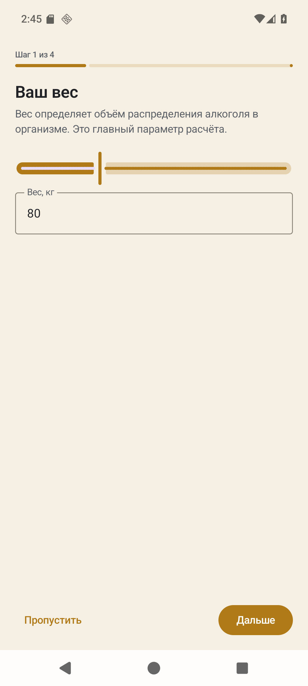
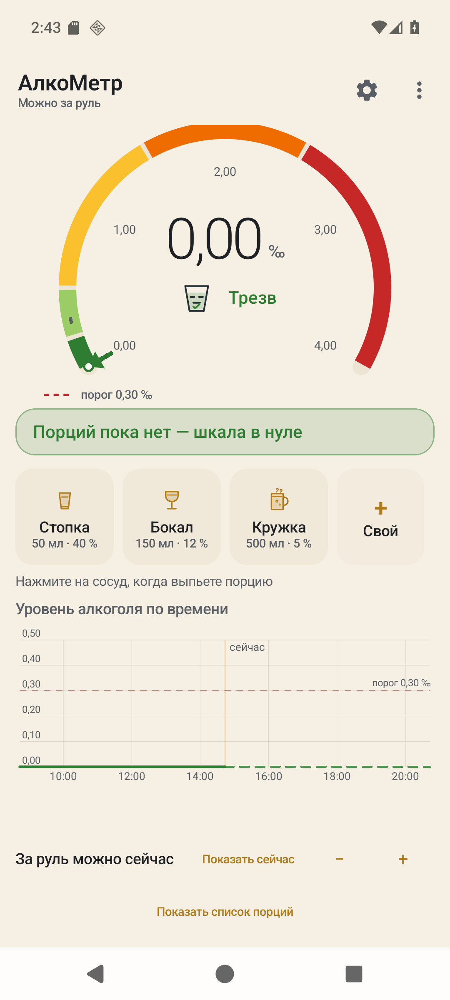
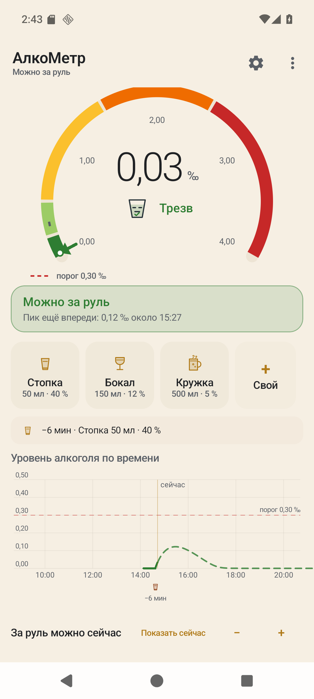
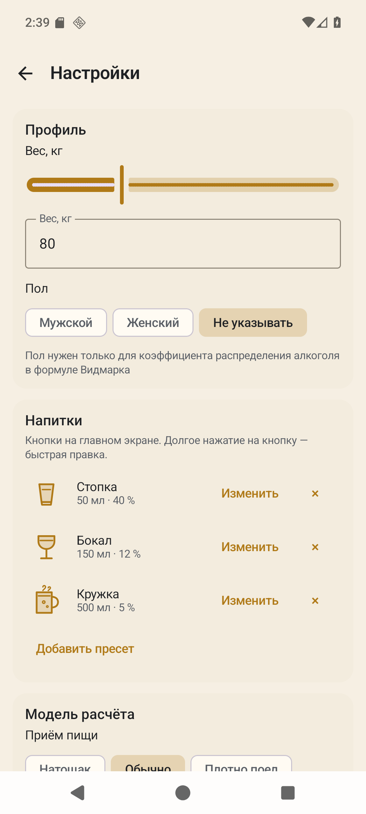
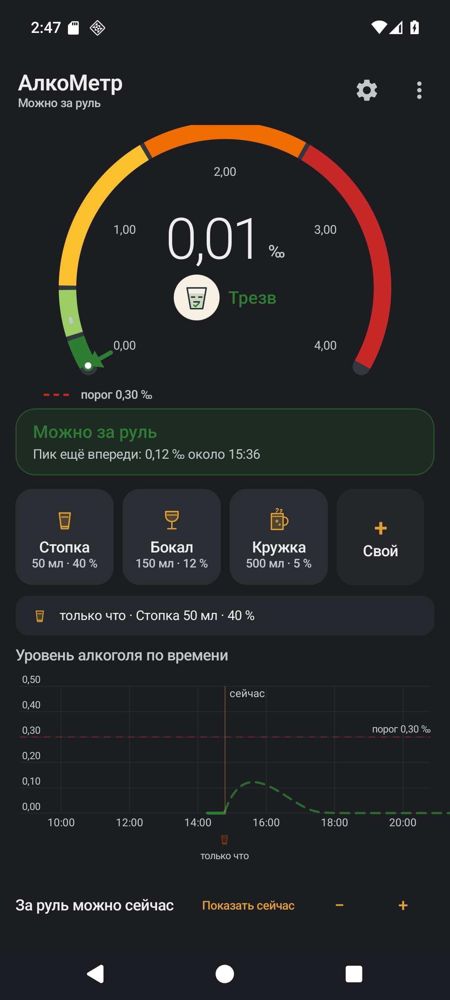

# АлкоМетр

Расчётный (не измерительный) трекер уровня алкоголя в крови. Android, Kotlin, Jetpack Compose.
Полностью офлайн: нет разрешения INTERNET, нет аналитики и рекламы.

Приложение не измеряет алкоголь, а моделирует его по выпитому: пользователь нажимает кнопку
с изображением стопки, бокала или кружки, а программа показывает, как уровень растёт (всасывание)
и как падает (метаболизм и выведение), — в реальном времени.

## Что умеет

| Экран | Что делает |
|---|---|
| Главный | Дуговая шкала 240° с пятью цветовыми зонами, крупное значение в ‰, маркер-стрелка, пунктир порога; в шапке — степень опьянения («Трезв»), в статусной карточке — «можно за руль» или «за руль через 2 ч 14 мин · около 23:40»; кнопки стопки/бокала/кружки (тап — порция сейчас, долгое нажатие — правка), «+ Свой» с объёмом, крепостью и временем; строка последней порции, «Отменить» — только для порции, добавленной в текущей сессии |
| Шкала времени | Кривая уровня: прошлое — сплошная линия с заливкой, будущее — пунктир; линия «сейчас»; пунктир порога и точка его пересечения с подписью времени; маркеры выпитых порций с давностью «−1 ч 20 мин»; перетаскивание двигает курсор и показывает уровень на выбранный момент и «до порога N»; масштаб 30 мин…48 ч — щипок двумя пальцами и кнопки; шкала закреплена внизу экрана, список порций открывается диалогом |
| Настройки | Вес (слайдер + поле), пол, рост, возраст; пресеты напитков (добавить/изменить/удалить, необязательное название); приём пищи → ka; метаболизм → Vmax; «Дополнительно» — ручные ka, Vmax, Km, r и сброс к рекомендуемым; пресеты порога подписаны странами (Россия 0,3 · Европа 0,5 · США 0,8 · нулевая толерантность · свой); единицы ‰ / % / мг/100 мл / мг/л; экспорт и импорт JSON, очистка истории, полный сброс; «О приложении» с версией, дисклеймером и ссылкой на репозиторий |
| История | Порции за 7 дней с датой, временем, объёмом и граммами спирта; свайп влево — удалить; «Добавить за прошлое время» |
| Первый запуск | Онбординг: вес → пол → порог → дисклеймер; можно пропустить, повторно не показывается |

Пять степеней опьянения — «Трезв», «Лёгкое», «Среднее», «Сильное», «Опасное отравление» —
со своими векторными иконками-персонажами; пятая пульсирует. Смена иконки — кроссфейд 250 мс.
Юридический порог и степень опьянения считаются раздельно: «можно за руль» — всегда по порогу.

## Скриншоты

**Внимание: кадры ниже — от предыдущей сборки (10.11.2026) и показывают интерфейс до правок
второго раунда.** Новая вёрстка не снята: эмулятор в этом окружении падает сразу после установки
APK — на машине одновременно активны WHPX и драйверы VMware Workstation 15.5.6. Обновить кадры
можно на любой машине с рабочим эмулятором: установить `dist\alkometr-0.1.0-debug.apk`
(`adb install -r`) и снять тот же набор экранов: онбординг, пустая сессия, сессия с порцией,
настройки, тёмная тема.

Скриншоты лежат в `docs/screenshots/` и входят в репозиторий, поэтому видны на странице GitHub.
Кадры сняты на сборке 10.11.2026 — до последних правок вёрстки (закреплённая шкала, рост и возраст в профиле);
актуальные будут добавлены после съёмки на рабочем эмуляторе или устройстве.
|---|---|
|  | Онбординг первого запуска: вес, пол, порог, дисклеймер; можно пропустить |
|  | Пустая сессия: «Трезв», нулевой уровень, «За руль можно сейчас», подсказка «Нажмите на сосуд, когда выпьете порцию» |
|  | После порции: уровень вырос, степень сменилась, на шкале времени — кривая, линия «сейчас» и маркер порции |
|  | Настройки: профиль, пресеты напитков, порог, единицы, резервная копия |
|  | Тёмная тема: та же шкала и шкала времени; иконки степеней получают светлую подложку, чтобы читаться на графите |

## Требования

* Android 8.0+ (minSdk 26), targetSdk 36;
* JDK 17 (проверено на Eclipse Temurin 17.0.20.1);
* Gradle 9.8.2 (wrapper), AGP 9.5.1, встроенный в AGP Kotlin 2.2.10;
* Compose BOM 2026.09.00, Material 3;
* Android SDK: `platforms;android-37.0`, `build-tools;37.0.0` (compileSdk 37 — см. «Отклонения»).

Сборка и эмулятор используют SDK установленной Android Studio:
`C:\Users\user\AppData\Local\Android\Sdk` (платформа `android-37.0`, `build-tools;37.0.0`, `emulator`, AVD Pixel_8).
Запуск эмулятора в этом окружении сейчас падает сразу после установки APK — см. «Скриншоты»;
сборка и проверки APK от эмулятора не зависят.
Файла `local.properties` в проекте нет намеренно: путь задают `tools\build.ps1` и `tools\check_apk.ps1`
через `ANDROID_HOME` / `ANDROID_SDK_ROOT`. Если SDK лежит в другом месте, поправьте `$sdk` в этих
скриптах либо задайте `ANDROID_HOME` перед прямым вызовом `gradlew.bat`.

## Быстрый старт

```powershell
# сборка debug APK
gradlew.bat :app:assembleDebug
# APK: app/build/outputs/apk/debug/app-debug.apk

# то же через скрипт, который сам находит JDK и SDK и пишет лог в docs/build-log.txt
powershell -ExecutionPolicy Bypass -File tools\build.ps1 -Tasks :app:assembleDebug
```

Установка на устройство:

```bash
adb install -r app/build/outputs/apk/debug/app-debug.apk
```

Размер debug-APK — **13,7 МБ** (13 698 182 байт = 13,06 МиБ). Готовая копия для установки:
`dist\alkometr-0.1.0-debug.apk`. Проверка `tools\check_apk.ps1` — 18 из 18 пунктов `[OK]`;
протокол — [`docs/verification.md`](docs/verification.md).

Release-сборка подписывается отдельным ключом, который лежит **вне репозитория**
(`%USERPROFILE%\.alkometr\keys`):

```powershell
gradlew.bat :app:assembleRelease
# APK: app/build/outputs/apk/release/app-release.apk
```

Размер release-APK — **8,9 МБ** (9 337 824 байта), подпись `CN=Alkometr`. Готовая копия:
`dist\alkometr-0.1.0-release.apk`. Проверка: `tools\check_apk.ps1 -Apk <путь> -Release`.

Подробная инструкция для новичка — [`docs/СБОРКА.md`](docs/СБОРКА.md): Android Studio, SDK 37,
создание и резервное копирование ключа, частые ошибки.
## Как считается

`C(t)` — концентрация в г/л (численно равно промилле). Масса спирта `D = V × (ABV/100) × 0,789 г`,
объём распределения `Vd = r × вес`. Всасывание — кинетика первого порядка (`da/dt = −ka·a`),
выведение — Михаэлис–Ментен (`dC/dt = input/Vd − Vmax·C/(Km+C)`), шаг интегрирования 1 минута,
горизонт прогноза 24 часа. Константы: r = 0,71/0,58/0,65; ka = 2,0/1,5/0,8 ч⁻¹;
Vmax = 0,15 г/л/ч (0,12…0,18); Km = 0,02 г/л.

Подробный разбор формул, обоснование констант и контрольные значения — в
[`docs/АЛГОРИТМ.md`](docs/АЛГОРИТМ.md). Эталонная реализация для сверки — `docs/_check_model.py`.

## Состав проекта

```
app/src/main/java/ru/alkometr/app/
  AlkometrApp.kt                 Application, репозитории
  MainActivity.kt                единственная Activity, edge-to-edge
  core/model/                    Drink, DrinkKind, Sex, UserProfile, ModelParams,
                                 IntoxicationLevel, Units, DrinkPreset, AppSettings
  core/engine/                   BacEngine (чистая математика), BacCurve, TimeToDrive
  core/format/Formatters.kt      «2 ч 14 мин», «0,42 ‰», даты и время
  data/                          SettingsRepository, DrinksRepository (DataStore + JSON), BackupCodec
  ui/theme/                      цвета, типографика, светлая и тёмная темы
  ui/main/                       MainScreen, MainViewModel, components/
                                 (BacGauge, BacTimeline, DrinkButtons, StatusCard, LevelIcon, DrinkDialog)
  ui/settings/                   SettingsScreen
  ui/history/                    HistoryScreen
  ui/onboarding/                 OnboardingScreen
  ui/AppRoot.kt                  навигация между экранами
app/src/main/res/drawable/       ic_level_1…5, ic_shot, ic_wine, ic_mug, ic_custom, ic_launcher_foreground
app/src/test/java/…              юнит-тесты JVM (31)
docs/                            ОТЧЁТ.md, ПРИЁМКА.md, АЛГОРИТМ.md, ЖУРНАЛ РАЗРАБОТКИ.md,
                                 ПРОМПТ, эталонный скрипт, логи, verification.md, screenshots/
tools/                           build.ps1, check_apk.ps1, publish_github.ps1,
                                 save_version.ps1, Сохранить версию.cmd
```
## Как читать код

Проект учебный, поэтому код прокомментирован подробно: у каждой смысловой строки есть объяснение,
что она делает и зачем. Всего более 2 000 строк комментариев; одинаковые конструкции (импорты,
закрывающие скобки, повторяющиеся вызовы) объяснены один раз, чтобы не дублировать.

Рекомендуемый порядок чтения:

1. `core/engine/BacEngine.kt` — математика: всасывание, выведение, шаг интегрирования.
2. `core/model/` — какие данные хранит приложение и в каких единицах.
3. `data/` — как настройки и порции сохраняются в DataStore.
4. `ui/main/MainViewModel.kt` — как данные превращаются в состояние экрана.
5. `ui/main/MainScreen.kt` и `ui/main/components/` — как состояние рисуется (шкала, таймлайн, кнопки).
6. `ui/settings`, `ui/onboarding`, `ui/history` — остальные экраны.
7. `app/src/test/` — юнит-тесты с пояснением, что и почему проверяется.
8. `res/values/strings.xml` и `res/drawable/` — тексты и иконки с комментариями по группам.

Совет: начните с `BacEngine.kt` — там нет Android, только Kotlin и формулы; затем переходите
к `MainViewModel`.

## Тесты

```powershell
gradlew.bat :app:testDebugUnitTest        # 31 юнит-тест, все зелёные
powershell -File tools\check_apk.ps1      # проверки APK без устройства
```

`BacEngineTest` (21 тест): пять контрольных сценариев из ТЗ с допуском ±0,02 ‰ и ±10 мин,
неотрицательность кривой, монотонное убывание после пика, наклон 0,15 ‰/ч на пост-абсорбционной
фазе, детерминизм, независимость от порядка порций, время до порога, пересчёт при удалении и
добавлении, границы пяти уровней, конверсия единиц, форматирование длительности, ноль через 48 ч,
прогноз по порогу, порции старше 24 ч (`drinksOlderThan24HoursDoNotAffectLevel`) и будущая порция.
`BacCurveTest` (6 тестов): интерполяция, поведение за границами окна, поиск пика, пересечение порога,
пустая кривая.
`BackupCodecTest` (4 теста): обратимость экспорта/импорта, отказ на чужом и битом файле,
стабильность и сортировка.

## Важные правила

1. Версии Gradle 9.8.2 и AGP 9.5.1 не подменять. Плагин `org.jetbrains.kotlin.android`
   не подключается: в AGP 9 Kotlin встроен.
2. `core/engine` не импортирует `android.*` — иначе юнит-тесты не запустятся на JVM.
3. Константы модели физиологически обоснованные; подгонять их под тесты запрещено.
4. «Можно за руль» считается по юридическому порогу, а не по степени опьянения.
5. Все пользовательские тексты — в `strings.xml`. Исключение: служебные строки `Formatters`,
   символы единиц в `Units` и сообщения импорта в `BackupCodec` — их проверяют JVM-тесты без
   контекста Android (см. «Отклонения от ТЗ»).
6. Никаких сетевых разрешений, аналитики, рекламы и сторонних иконок: все иконки — собственные
   VectorDrawable в `res/drawable`.
7. Ключи и `local.properties` в репозиторий не попадают.
8. Release-ключ и пароли лежат в `%USERPROFILE%\.alkometr\keys`; их нельзя коммитить, а папку нужно сохранить в резервной копии — потеря ключа не даст выпустить обновление.

## Отклонения от ТЗ

| Пункт ТЗ | Факт | Причина |
|---|---|---|
| compileSdk/targetSdk 36 | compileSdk **37**, targetSdk **36** | Compose BOM 2026.09.00 (Compose 1.12.1) требует compileSdk 37; платформа `android-37.0` — стабильный релиз. ТЗ разрешает максимальный стабильный compileSdk |
| «Compose включается через `buildFeatures.compose`» | дополнительно подключён плагин `org.jetbrains.kotlin.plugin.compose` 2.2.10 | без него AGP 9.5.1 падает: «Starting in Kotlin 2.0, the Compose Compiler Gradle plugin is required» |
| kotlinx.serialization (без версии) | 1.9.0 | версия 1.12.0 собрана Kotlin 2.4 и несовместима со встроенным компилятором AGP 2.2.10 (ошибка metadata 2.4.0) |
| Навигация | ручное состояние экранов + `BackHandler` | экранов три, библиотека навигации даёт лишнюю зависимость |
| Иконка степени в центре шкалы — 72 dp | **42 dp** | в центре дуги в одном столбце стоят число, единица и подпись степени; 42 dp оставляют место числу и работают при крупном системном шрифте |
| Масштаб шкалы времени 0,5×…6× | **30 мин…48 ч** (панорама двумя пальцами + кнопки) | абсолютное окно понятнее кратности; 48 ч согласованы с горизонтом прогноза 24 ч, нижняя граница 30 мин даёт разобрать одну порцию |
| «Отменить» для последней порции | только для порции, добавленной в текущей сессии | кнопка отменяет последнее действие в приложении, а не правит историю; старые порции удаляются в «Истории» свайвом |
| Отдельные `SettingsViewModel` / `HistoryViewModel` | всё через `MainViewModel` | один источник состояния «порции + настройки + кривая»; отдельные VM дублировали бы подписки и пересчёт |
| Все пользовательские строки в `strings.xml` | подписи длительности — в `Formatters`, символы единиц — в `Units`, сообщения импорта — в `BackupCodec` | эти строки проверяют JVM-тесты без контекста Android (например, `timeFormatter_ru` ждёт «2 ч 14 мин»); сообщения `BackupCodec` показываются как текст ошибки импорта |
| Всплывающее «+0,28 ‰» — фактический прирост | верхняя оценка `D / Vd` | мгновенный прирост зависит от фазы всасывания и выведения и всегда меньше `D / Vd`; показываем верхнюю границу, чтобы не занижать |

## Репозиторий

Репозиторий создан: **[github.com/alexazver-jpg/alkometr](https://github.com/alexazver-jpg/alkometr)** —
приватный (`isPrivate = true`), владелец `alexazver-jpg`, создан через GitHub API. Ветка — `main`,
remote — `origin` (`https://github.com/alexazver-jpg/alkometr.git`).

Ссылка вписана в приложение: строка `settings_repository_url` в `res/values/strings.xml` содержит адрес
репозитория, поэтому блок «Репозиторий проекта» в «О приложении» показывается и открывает его в браузере.

### Как обновлять

1. Внести изменения в код или документы.
2. Обновить `ReadMe.md`: затронутые разделы и, если менялось поведение, «Историю версий».
3. Добавить запись в [`docs/ЖУРНАЛ РАЗРАБОТКИ.md`](docs/ЖУРНАЛ%20РАЗРАБОТКИ.md).
4. Закоммитить в `main` и запушить — `git push origin main`.

Правило владельца: изменение не считается внесённым, пока не сделан коммит в `main` и не обновлён
`ReadMe.md`. То же правило действует для локального архива `E:\ProectsAutoClaw\АлкоМетр\`.

Скрипт `tools\publish_github.ps1` (создание приватного репозитория через `gh` или `GITHUB_TOKEN`
без записи токена в файл) оставлен на случай пересоздания репозитория; в текущем состоянии запускать
его не нужно.

## История версий

* **0.1.0** — первый рабочий выпуск: движок BAC, главный экран, шкала времени, настройки,
  онбординг, история, пять иконок, тёмная тема.
* **0.1.0, второй раунд (11.11.2026)** — исправления по аудиту ТЗ: степень в шапке вместо статуса,
  горизонт 24 ч для старых порций, кэш кривой с обновлением раз в 5 минут, название пресета,
  пресеты порога по странам, валидация крепости 0,1…96 %, закреплённая шкала времени и список
  порций в диалоге, рост и возраст в профиле, ссылка на репозиторий в «О приложении» и скрипт
  публикации.
  Номер версии и `versionCode` не менялись — APK пересобран из того же `0.1.0` (1).
* **0.1.0, release (11.11.2026)** — подписанный release-APK (8,9 МБ), отдельный ключ вне репозитория, инструкция docs/СБОРКА.md.
* Локальный git-архив: `E:\ProectsAutoClaw\АлкоМетр\` (папки `Программа`, `Документы`, `Тесты`,
  `Инструменты`; скрипт `Сохранить версию.cmd`).
* **11.11.2026, публикация** — приватный репозиторий
  [github.com/alexazver-jpg/alkometr](https://github.com/alexazver-jpg/alkometr), ветка `main`,
  ссылка в «О приложении» (`settings_repository_url`). Подробности — [`docs/ОТЧЁТ.md`](docs/ОТЧЁТ.md),
  раздел 1.

## Дисклеймер

«АлкоМетр» рассчитывает уровень алкоголя по формуле Видмарка и средней скорости метаболизма.
Это приблизительная оценка, а не медицинское измерение. Индивидуальные отклонения достигают 30 %.
Приложение не заменяет алкотестер и не является доказательством в спорах. Никогда не садитесь
за руль после алкоголя, даже если приложение показывает допустимое значение. При признаках
тяжёлого опьянения (потеря сознания, рвота, холодная кожа) — зовите скорую (112).

## Лицензия

Проприетарная, all rights reserved — проект приватный.
